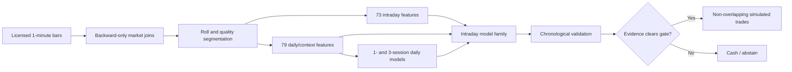

# Causal Natural-Gas Forecasting Research

A research-grade, multi-horizon forecasting pipeline for NYMEX Henry Hub natural
gas. The project combines one-minute market data with slower daily context while
enforcing strict information timing, futures-roll safety, chronological model
selection, explicit trading costs, and a cash/abstain outcome.

This repository is designed as a technical portfolio project. Licensed market
data, credentials, trained model binaries, and experiment outputs are deliberately
not included.

## What this project demonstrates

- Causal feature engineering over irregular one-minute futures data.
- Roll-safe natural-gas and WTI return indices.
- A two-level forecasting design: daily regime estimates condition 5-, 15-, and
  30-minute forecasts.
- LightGBM, Explainable Boosting Machines, random forest, ExtraTrees, ridge, and
  ensemble comparisons under identical samples.
- Chronological train, early-stop, calibration, validation, and evaluation
  partitions with target-time purging.
- Delayed executable prices, non-overlapping trades, event windows, cost stress,
  bootstrap uncertainty, and a legitimate decision to remain in cash.
- Deterministic tests for future leakage, label availability, roll handling,
  indicator timing, accounting, and frozen-model inference.



## Quick start

Python 3.12 or newer is required.

```bash
python -m venv .venv
source .venv/bin/activate
python -m pip install -e .
python -m unittest discover -s tests -v
python examples/synthetic_demo.py
```

The tests and synthetic demonstration do not require proprietary data.
On macOS, LightGBM also needs an OpenMP runtime; install one with your system
package manager if the dynamic loader reports that `libomp` is missing.

To run the full experiment with a compatible licensed Parquet file:

```bash
python train_context.py \
  --data /path/to/ng_augmented_ohlcv_1m.parquet \
  --output outputs/context_run \
  --development-start 2026-05-01 \
  --holdout-start 2026-08-01 \
  --cost-ticks 2
```

Choose dates that exist in your input. Output directories must not already exist;
this protects prior experiments from accidental overwrite.

## Research status

The work should be evaluated as a forecasting and model-governance system, not as
a claim of live profitability. In the historical study that motivated this
package, the daily layer showed modest directional information at one- and
three-session horizons, while the registered strategy selector did not find
sufficiently stable after-cost evidence to enable deployment. The pipeline's
ability to select cash is intentional and is one of its core risk controls.

That conclusion is materially more defensible than selecting the best rule after
examining an evaluation period. No broker integration is included and every
serialized bundle retains `deployment_enabled=False`.

## Repository map

| Path | Purpose |
|---|---|
| `advanced_data.py` | Causal intraday features and executable labels |
| `daily_context.py` | Daily sessions, trends, RSI, bands, divergence, seasonality, NG–WTI context |
| `daily_models.py` | Expanding daily forecasts and daily-to-intraday adjustment |
| `advanced_estimators.py` | Comparable estimator suite and fitted wrappers |
| `advanced_backtest.py` | Policy gates, non-overlapping trades, costs, and uncertainty |
| `train_context.py` | End-to-end registered daily-context experiment |
| `train_advanced.py` | Shared configuration, splits, summaries, and baseline experiment |
| `predict_context.py` | Offline as-of inference from trusted frozen bundles |
| `download_*.py`, `build_*.py` | Optional licensed-data acquisition and construction |
| `tests/` | 38 deterministic causality and accounting tests |
| `docs/TECHNICAL_REPORT.md` | Full process, methodology, assumptions, and checks |
| `docs/DATA_CONTRACT.md` | Required input fields and timing semantics |

## Data and credential policy

Market data is excluded because it is licensed. Obtain it under your own vendor
agreement or map another source to the documented schema. Download scripts prompt
for credentials without storing them. Never commit API keys, `.env` files, DBN,
Parquet, Excel, joblib, predictions, or generated output folders.

## Important limitations

This is retrospective research. Calendar terms are proxies, the NG–WTI
relationship can change, and technical indicators do not guarantee reversals.
Weather forecasts, physical production/flow data, storage expectations, and a
real order book are outside the supplied dataset. See the technical report for
the complete assumptions and validation boundary.

## License

Code is released under the MIT License. Vendor data and vendor-derived artifacts
remain subject to their respective licenses.
